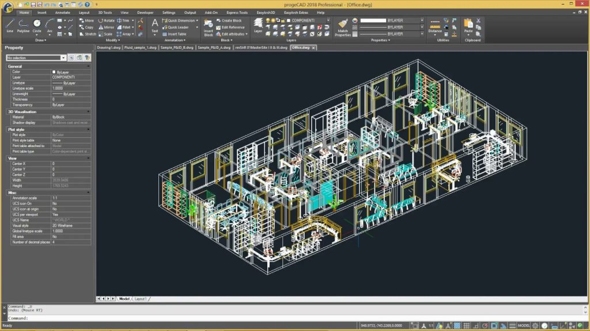

# progeCAD for Technical Drawing and DWG Workflows

progeCAD Professional is a CAD application for technical drafting and modeling.
It works with DWG drawings and provides tools for both two-dimensional and three-dimensional work.

This independent ProgeCAD Pro guide focuses on drawing organization, exchange, and review.
ProgeCAD capabilities should be checked against the exact edition and release being used.

[](https://progecad-pro.github.io/ProgeCAD/)

The supplied source snapshot belongs to LibreCAD, a separate open-source CAD application.
Its linked files provide comparative references for test fixtures, font tooling, and build configuration.
They are not progeCAD source code, progeCAD settings, or a progeCAD installer.

## Overview

A 2D CAD workflow should establish units, layer conventions, and output requirements.
A drawing that looks correct on screen can still contain an unintended scale or missing reference.

| Drawing concern | Working approach | Review before handoff |
| --- | --- | --- |
| Units | Agree on the meaning of drawing coordinates | Measure a known feature after exchange |
| Layers | Separate geometry according to its purpose | Check visibility, naming, and plotting behavior |
| Dimensions | Use consistent annotation conventions | Compare displayed values with the intended geometry |
| Text | Choose fonts available to the receiving workflow | Inspect substitutions, symbols, and line wrapping |
| External references | Keep referenced resources identifiable | Confirm that required files are available |
| Printed output | Define sheet size and plotting scale | Review the final PDF at the intended paper size |

For 3D CAD work, confirm the receiving application's supported objects and exchange formats.
Inspect the resulting model rather than assuming that a successful import preserved every feature.

A DWG CAD handoff should include the intended drawing version and any required supporting resources.
Keep an editable master separately from delivery copies prepared for a specific recipient.

- Record units and the expected scale.
- Identify fonts and reference files used by the project.
- Review dimensions and text after saving to another format.
- Preserve a known-good revision before a major conversion.

The [official progeCAD overview](https://www.progesoft.com/products/progecad-professional) describes product scope and supported workflows.
Use release-specific documentation when checking format and feature compatibility.


## Users Documentation

A useful drawing review combines visual inspection with a few measurable checks.
Choose a known distance and compare its value before and after file exchange.

For an existing DXF file, the following Python example uses the separate ezdxf library.
It reports the document version, drawing-unit code, and selected modelspace entity counts.

```python
import ezdxf
drawing = ezdxf.readfile("exchange.dxf")
model = drawing.modelspace()
print("DXF version:", drawing.dxfversion)
print("Drawing unit code:", drawing.units)
for entity_type in ("LINE", "LWPOLYLINE", "TEXT", "DIMENSION"):
    print(entity_type, len(model.query(entity_type)))
```

This assumes Python and ezdxf are already available and exchange.dxf exists.
It reads the drawing without saving changes or invoking progeCAD.

The [ezdxf usage documentation](https://ezdxf.readthedocs.io/en/stable/usage_for_beginners.html) describes loading and querying DXF files.
Its [units reference](https://ezdxf.readthedocs.io/en/stable/concepts/units.html) explains the document unit code.

Entity counts do not establish geometric accuracy or complete compatibility.
The example queries modelspace and does not count entities nested inside block definitions.

Text needs a separate review because character coverage and rendering can vary.
Check technical symbols, accented characters, and any right-to-left labels used in the drawing.

The supplied LibreCAD font references are:

- [main.cpp](tools/ttf2lff/main.cpp), the entry point for its font conversion utility.
- [freetype.pri](tools/ttf2lff/freetype.pri), which configures FreeType dependencies.
- [main.cpp](tools/arabic-font-probe/main.cpp), an Arabic font probing tool.
- [verify_cmap.py](tools/arabic-font-probe/verify_cmap.py), which checks font character coverage.

These files concern LibreCAD font tooling.
They do not define progeCAD font installation or conversion commands.

## Requests and Bug Reports

A useful report identifies the operation that changes the drawing unexpectedly.
Distinguish opening, editing, saving, plotting, and viewing in another application.

Include the relevant details:

- progeCAD version and edition.
- Operating system and the affected file format.
- The drawing's intended units and one known measurement.
- The smallest sequence that reproduces the issue.
- Whether the problem also appears in a new drawing.
- The expected result and the observed result.

For a file-exchange issue, compare the source and saved copy at the same stage.
A change in the viewer's display settings can otherwise look like a change in drawing geometry.

The supplied LibreCAD fixture definitions illustrate another project's testing organization:

- [fixture_manifest.json](tests/fixtures/fixture_manifest.json) lists drawing test fixtures.
- [fixture_manifest.schema.json](tests/fixtures/schemas/fixture_manifest.schema.json) describes the manifest structure.
- [oracles.json](tests/fixtures/oracles.json) configures external comparison tools.
- [oracles.json.example](tests/fixtures/oracles.json.example) provides a comparison-tool configuration example.

Their referenced external paths are not evidence that the corresponding drawings are included.
Do not treat these files as progeCAD jobs or ready-to-run compatibility tests.

The related validation schemas are:

- [oracles.schema.json](tests/fixtures/schemas/oracles.schema.json) for comparison-tool configuration.
- [oracle_receipt.schema.json](tests/fixtures/schemas/oracle_receipt.schema.json) for external comparison receipts.
- [audit.schema.json](tests/fixtures/schemas/audit.schema.json) for audit reports.
- [audit_diff.schema.json](tests/fixtures/schemas/audit_diff.schema.json) for audit differences.

Those schemas describe LibreCAD testing data.
They do not validate a progeCAD drawing simply by being present in this repository.



## Community

When discussing a drawing, separate design intent from application behavior.
Explain whether a dimension is a requirement, an annotation, or a measured result.

- Share a small example that preserves the problem.
- Remove private project information.
- Identify the originating and receiving applications.
- Include the format and version used for exchange.
- Explain whether the discrepancy affects editing or only presentation.

A delivery checksum can identify the exact drawing copy being discussed.
The following PowerShell example reads an existing DWG file and displays its SHA-256 digest.

```powershell
$drawingPath = "approved-plan.dwg"
$drawingDigest = Get-FileHash -LiteralPath $drawingPath -Algorithm SHA256
$drawingDigest | Format-List Algorithm, Hash, Path
```

This uses Microsoft's [Get-FileHash](https://learn.microsoft.com/en-us/powershell/module/microsoft.powershell.utility/get-filehash) cmdlet.
It does not open the drawing in a CAD application or modify its contents.

Matching hashes help compare copies of a file.
They do not establish that dimensions, layers, or plotting settings are correct.

## Contributing

Documentation changes should clarify a drafting decision or correct a verified product detail.
Identify the application associated with every source reference and code example.

The supplied LibreCAD development configuration includes:

- [settings.pri](settings.pri), which defines platform-dependent project settings.
- [common.pri](common.pri), which collects shared project configuration.
- [qt512.conf](CI/qt512.conf), which records Qt paths for a CI environment.
- [CMakePresets.json](CMakePresets.json), which defines CMake configuration presets.

These files belong to LibreCAD development.
They are not progeCAD preferences, plug-ins, or a build recipe for progeCAD.

Before publishing a procedure, check the application version and required dependencies.
Describe whether the example was tested or is illustrative.

Keep the source drawing, reference resources, and reviewed delivery output together.
This gives later revisions a clear basis for comparison.

For product-specific instruction, consult the [official progeCAD tutorials](https://www.progesoft.com/video-tutorial/progeCAD-professional-media-video).
Use the vendor's documentation to verify commands before adding automation examples.

## Related Search Terms

ProgeCAD Pro, ProgeCAD, 2D CAD, 3D CAD, DWG CAD, cad, 2d, 3d, drawing, dxf, dwg, geometry, engineering, architecture, technical-drawing
